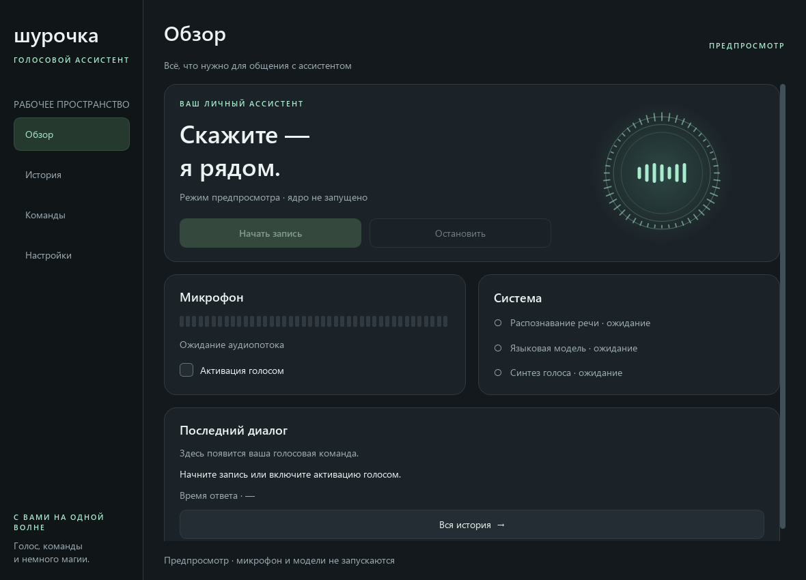
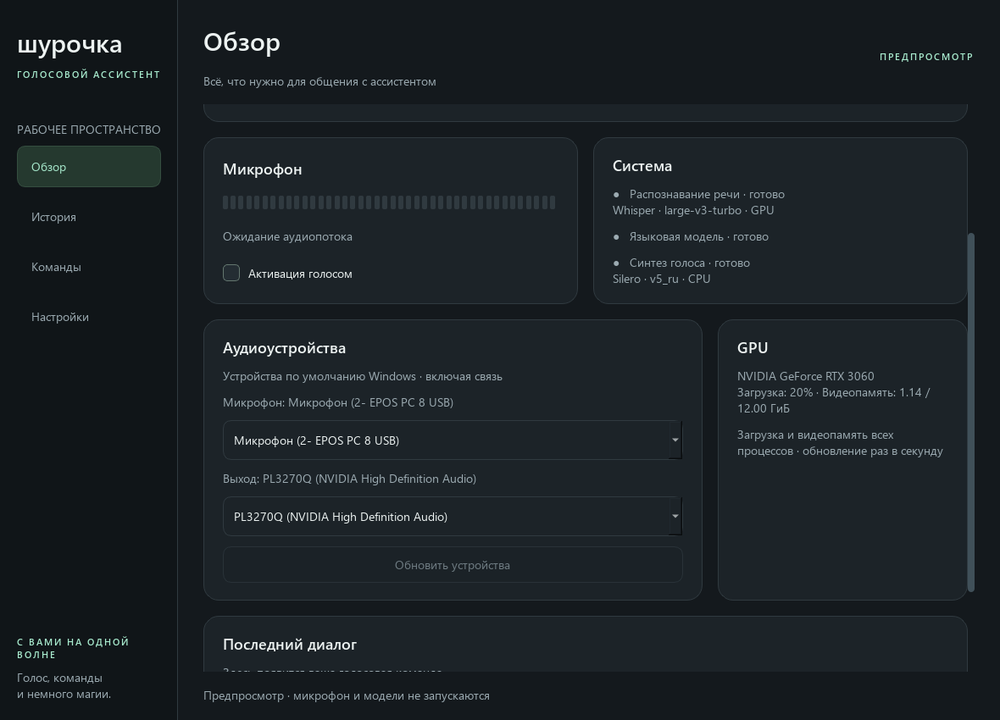

# Новый интерфейс Шурочки

Независимая реализация в `ui/modern/`. Старые `ui/tkinter_ui.py` и
`ui/pyside6/dashboard.py` не изменены. Используется уже имеющаяся зависимость PySide6.

## Запуск

```powershell
python main.py                         # новый интерфейс по умолчанию
python main.py --ui modern --no-ipc     # без IPC-сервера
python -m ui.modern                    # отдельная точка входа
python -m ui.modern --preview          # дизайн без моделей, IPC и микрофона
python main.py --ui tkinter            # прежний Tkinter
python main.py --ui pyside6            # прежний Dashboard
```

В предпросмотре реальные операции отключены; состояние служб не имитируется.
Он позволяет проверять навигацию, размеры окна и оформление без загрузки ядра.

При обычном запуске также сначала открывается только интерфейс. Нажмите
«Начать работу»: модели, микрофон и IPC запускаются в фоновом потоке, затем
включается прослушивание кодового слова. Повторное нажатие не запускает загрузку
ещё раз. В этом интерфейсе запуск по кнопке включает голосовую активацию независимо
от настройки `wake_word.enabled_at_startup` для прежних интерфейсов.

Во время подготовки засечки голосового круга заполняются мятным цветом по часовой
стрелке от верхней точки. Под статусом показано прошедшее время. Первоначальный
прогноз — 25 секунд, затем используется среднее последних пяти успешных запусков
из отдельного журнала `logs/model_startup.jsonl` (в настроенном `paths.logs_dir`).
Журнал содержит дату завершения, длительность в секундах, результат, текущее
среднее и число учитываемых запусков. Измеряется вся подготовка от нажатия кнопки
до готовности, включая модели, калибровку и запуск служб.

Если загрузка идёт дольше прогноза, последняя засечка остаётся незаполненной,
а подпись просит ещё подождать. При готовности круг полностью заполняется,
затем возвращается к обычному виду. Ошибки и закрытие во время подготовки
записываются в журнал, но не участвуют в среднем. Переход на другую страницу
не сбрасывает отсчёт. Заполнение работает и при отключённой декоративной анимации.

«Остановить» приостанавливает прослушивание кодового слова и меняется на
«Возобновить». Модели остаются в памяти, текущая активная команда может завершиться.
«Возобновить» снова включает прослушивание без загрузки моделей. Флажок
«Активация голосом» управляет тем же режимом. После запуска ручная запись доступна
по `Ctrl+Space`, отмена текущей операции — по `Esc`.

«Вся история» на обзоре открывает в проводнике папку `paths.session_base_dir`
(по умолчанию `~/Shura`) с заметками и снимками всех запусков. Папка появляется
после первого сохранения. Раздел «История» в боковой панели показывает диалоги
текущей сессии.

### HTML-журнал заметок со скриншотами

На странице «Настройки» в карточке «Заметки» включите «Сохранять заметки со
скриншотом в HTML-журнал». По умолчанию режим выключен. Флажок сохраняется в
`settings.toml` как `notes.html_with_screenshot = true` и применяется к следующим
заметкам без перезапуска; его можно изменить до нажатия «Начать работу».

Используйте обычную команду «запиши заметку». После определения команды экран
снимается перед дополнительной диктовкой. Изображение сохраняется только после
получения текста: при тишине, отмене или ошибке распознавания файлов не создаётся.
Если вся заметка произнесена одной фразой, снимок делается после распознавания команды.

Текст продолжает добавляться в прежний `notes.txt`, а заметка с изображением —
в `<session_base_dir>/YYYY-MM/notes.html`. Журнал общий для месяца, включая повторные
запуски и режим `per_session`; расположение TXT определяется `paths.session_layout`.
Месяц выбирается по времени сохранения, а время захвата показано отдельно под снимком.
Первое сохранение в новом месяце создаёт новый журнал. Старые TXT автоматически
не переносятся в HTML.

Кнопка «Открыть журнал текущего месяца» открывает его в браузере. Рядом с текстом
показана миниатюра; клик открывает оригинал поверх страницы. «Масштаб 100%» позволяет
рассмотреть детали с прокруткой, «Вписать в окно» возвращает общий вид. Закрытие —
по кнопке, фону или Esc. Журнал работает без интернета.

Оригиналы PNG лежат рядом с HTML, уменьшенные копии — в `thumbnails/`. Для переноса
или резервной копии сохраняйте всю папку месяца вместе с изображениями.
Если снимок не получен или не записан, текст сохраняется в TXT и HTML с отметкой
«Скриншот недоступен». Если не обновился HTML, сохраняется TXT; приложение показывает
и озвучивает предупреждение. Ошибка записи TXT не подтверждается как сохранение.
В режиме предпросмотра изменение флажка не сохраняется.

### Если Whisper сообщает, что CUDA недоступна

Проверяйте тот же Python, которым запускаете приложение:

```powershell
python -c "import sys, torch; print(sys.executable); print(torch.__version__, torch.version.cuda, torch.cuda.is_available())"
nvidia-smi
```

`torch.version.cuda = None` означает CPU-сборку PyTorch, даже если NVIDIA GPU
исправно отображается в `nvidia-smi`. Для используемого проектом PyTorch 2.6
на Python 3.10 / Windows согласованный набор CUDA 12.4 устанавливается так:

```powershell
python -m pip install torch==2.6.0+cu124 torchvision==0.21.0+cu124 torchaudio==2.6.0+cu124 --index-url https://download.pytorch.org/whl/cu124
```

Это изменяет пакеты выбранного Python. Закройте приложение перед установкой
и запустите заново после неё. Версии согласованы с
[официальной таблицей PyTorch](https://docs.pytorch.org/get-started/previous-versions/).
Если GPU отсутствует, явно задайте `whisper_device = "cpu"` в секции `[stt]`
файла `settings.toml`; большой Whisper на CPU может работать медленно.



## Возможности

### Самостоятельное распознавание и озвучка

Разделы «Распознавание речи» и «Озвучка текста» доступны сразу после открытия
окна. Нажимать «Начать работу» на обзоре не требуется. Модель загружается при
первой операции, используются текущие настройки Whisper/TTS и голоса. LLM,
IPC, напоминания и прослушивание кодового слова при этом не запускаются.

**Распознавание речи:** нажмите «Начать» для непрерывной диктовки или «Открыть
WAV / FLAC» для аудиофайла. Текст дописывается в редактируемое поле; его можно
скопировать, очистить и сохранить в UTF-8 TXT. Стерео и другая частота
дискретизации преобразуются для Whisper автоматически.

«Стоп» завершает захват и распознаёт накопленное, включая последнюю фразу.
«Отменить» прекращает дальнейшую обработку; готовый текст остаётся. Запись
продолжается во время распознавания предыдущих фраз. Если очередь из десяти
сегментов переполнилась, запись останавливается с сообщением, уже записанные
сегменты обрабатываются.

Для работы в другом приложении включите «Плавающая кнопка и Ctrl+Alt+D».
Появится перемещаемое окно, которое не забирает фокус у редактора. Установите
курсор в нужное поле и запустите диктовку кнопкой или Ctrl+Alt+D; повторное
нажатие завершает запись. Этот способ автоматически выбирает режим
«В активное приложение». Положение кнопки сохраняется; её показ и хоткей
включаются заново в каждой сессии.

Каждая готовая фраза вставляется в окно, активное в момент получения результата.
При переключении приложения текст следует за фокусом. В окна самой Шурочки
внешняя вставка пропускается. Копия каждой фразы остаётся в разделе STT.
Вставка не меняет буфер обмена и не нажимает Enter. Приложения с повышенными
правами или нестандартными полями могут не принимать синтетический ввод;
при обнаруженной ошибке автоматического повтора нет, текст можно скопировать
из раздела STT. Перед вставкой отпустите Ctrl, Alt, Shift и Win.

**Озвучка текста:** введите текст и нажмите «Озвучить» либо «Сохранить WAV».
Длинный текст обрабатывается частями, прогресс показан под полем. Итоговый
WAV PCM16 содержит все части. До изменения текста воспроизведение и сохранение
используют готовое аудио. «Остановить» отменяет дальнейшую работу; завершение
текущего вызова модели может занять время. Незавершённое аудио не экспортируется.

Инструменты и ассистент выполняют речевые операции последовательно и используют
общие модели. На время инструмента голосовая активация приостанавливается,
после него восстанавливается с учётом последнего выбора пользователя. Работа
с аудиофайлом и синтез текста не открывают микрофон. Экспорт выполняется в фоне;
ошибка сохранения оставляет готовый результат доступным для повторной попытки.

В режиме `--preview` реальные операции, вставка и хоткей отключены. Проверить
вёрстку без моделей можно командой `python -m scripts.preview_speech_tools`:
изображения двух размеров окна записываются в `build/speech-preview/`.

### Ассистент

- Обзор: запуск работы, пауза и возобновление активации кодовым словом, реальный уровень
  микрофона, состояние STT/LLM/TTS, названия моделей STT/TTS и их режим CPU/GPU,
  аудиоустройства Windows, показатели GPU, последний диалог и время обработки.
- История: последние 200 диалогов текущей сессии, поиск, экспорт UTF-8,
  очистка с подтверждением. Текст модели отображается как текст, а не HTML.
- Команды: поиск по фактическому реестру запущенного ядра, включая пользовательские
  синонимы из TOML; копирование фразы. Сам интерфейс не определяет голосовые команды.
- Настройки: список и переключение моделей текущей сессии, калибровка микрофона,
  порог речи, отключение анимации, HTML-журнал заметок со скриншотами,
  открытие журнала и папок проекта и материалов.
- Горячие клавиши внутри окна: `Ctrl+Space` — запись, `Esc` — отмена,
  `Ctrl+1…6` — переход между разделами: обзор, STT, TTS, история, команды, настройки.
- Размер окна, выбранный раздел и настройка анимации сохраняются через `QSettings`
  (`Shura/ModernUI`, реестр Windows). Предпросмотр не сохраняет эти настройки.
- Страницы прокручиваются при небольшом размере окна; минимум 940×680.
  Анимация приостанавливается на скрытой странице и в состоянии ожидания.

### Аудиоустройства и GPU

В карточке «Аудиоустройства» выбираются системные микрофон и выход Windows.
Выбор применяется сразу ко всем трём ролям, включая связь. Программы с собственным
закреплённым устройством могут продолжить использовать его. Под списками показаны
фактические устройства Шурочки; при внешнем переключении указано ожидание переподключения.

Выбор сохраняется по устойчивому Windows endpoint ID в `QSettings` (`audio/input`,
`audio/output`) после успешного переключения. При следующем запуске сохранённые
устройства снова становятся системными. Если устройство отсутствует, используются
текущие defaults Windows и показывается уведомление. На закрытии defaults не возвращаются.

Переключение ждёт завершения текущей голосовой операции, приостанавливает активацию
кодовым словом и выполняется под общей блокировкой pipeline. Новый микрофон калибруется;
во время измерения нужно молчать. При ошибке приложение восстанавливает предыдущий
поток и отдельные defaults каждой роли Windows. Если восстановление невозможно,
запись отключается до успешного выбора устройства. Кнопка «Обновить устройства»
также позволяет повторить неудачное переподключение. Список проверяется каждые две секунды.

Windows endpoints сопоставляются с WASAPI по имени и направлению. Неоднозначные
имена вызывают явную ошибку. Перечисление PortAudio обновляется только при остановленных
потоках и под блокировкой pipeline. Общий режим WASAPI использует
[системное преобразование частоты](https://python-sounddevice.readthedocs.io/en/0.5.6/api/platform-specific-settings.html)
для входа и выхода.

Карточка «GPU» показывает общую загрузку и видеопамять всех процессов на каждой
NVIDIA-видеокарте. Метрики обновляются раз в секунду независимо от голосовых операций
и доступности LLM. Требуются драйвер NVIDIA и `nvidia-ml-py` из `requirements.txt`.
При отсутствии поддержки отображается причина; недоступная метрика обозначается «—».
Для AMD/Intel мониторинг пока не реализован. Предпросмотр не запускает мониторинг
и не изменяет системные аудиоустройства.



Провайдеры, устройства и голос по-прежнему настраиваются через `settings.toml`
с перезапуском приложения. Новый интерфейс не содержит редактор всех полей TOML.
Трей, глобальные горячие клавиши, Bluetooth-панель и полноэкранные оверлеи прежних
интерфейсов пока не перенесены; прежние точки входа остаются доступны.

## Структура и расширение

| Файл | Ответственность |
|---|---|
| `app.py`, `__main__.py` | Создание приложения, обычный запуск и предпросмотр |
| `window.py` | Оболочка, навигация, реестр `PageSpec`, состояния действий |
| `pages.py` | Четыре независимые страницы |
| `speech_pages.py`, `speech_backend.py` | Страницы STT/TTS, плавающая кнопка и независимые фоновые речевые операции |
| `components.py` | Карточки, кнопки, типографика, уровнемер, голосовой индикатор |
| `theme.py` | Палитра и QSS; оформление меняется централизованно |
| `backend.py` | Единственное место интеграции с `VoicePipeline`, IPC и wake-word |

Для нового модуля создайте отдельный файл страницы, например
`ui/modern/notes_page.py`. Страница получает контекст окна: `backend`,
`navigate(key)`, `notify(text)`, `settings`. Она подписывается на сигналы backend
и вызывает его публичные методы. Прямого доступа к моделям и микрофону у страницы нет.

```python
from PySide6.QtWidgets import QVBoxLayout, QWidget
from ui.modern.components import Card, label
from ui.modern.window import ModernWindow, PageSpec

class NotesPage(QWidget):
    def __init__(self, context):
        super().__init__()
        layout = QVBoxLayout(self)
        card = Card("Заметки")
        card.body.addWidget(label("Материалы текущей сессии", "muted"))
        layout.addWidget(card)

# В app.py при создании окна:
window = ModernWindow(backend, extra_pages=(
    PageSpec("notes", "Заметки", "Ваши сохранённые материалы", NotesPage),
))
```

Для встроенной страницы можно добавить `PageSpec` в `DEFAULT_PAGES`.
Кнопка навигации, контейнер прокрутки, заголовок и сочетание клавиш создаются
автоматически. Ключи должны быть уникальными; неизвестный сохранённый ключ
возвращает пользователя на обзор. Новые страницы не должны предполагать, что
другие страницы уже построены в момент их конструктора.

Медленные операции добавляются в очередь `AssistantBackend`, а результаты —
в новые Qt-сигналы. UI изменяется только из главного потока. Инициализация,
сетевые проверки, работа моделей и освобождение ресурсов выполняются в рабочем
потоке. Проверки здоровья объединяются, чтобы очередь не росла при долгом ответе.
При закрытии окно остаётся отзывчивым и ждёт освобождения ресурсов; поток не
обрывается принудительно. Зависший сторонний провайдер может задержать закрытие.

## Проверка

```powershell
python -m pytest tests/test_modern_ui.py -q
python -m pytest -q
```

Тесты запускают Qt без экрана и подменяют ядро. Проверяются навигация и добавление
страницы, состояния действий, фильтрация команд, безопасный вывод истории,
предпросмотр, выбор модели, ошибка инициализации, очистка ресурсов, принадлежность
таймеров UI-потоку и асинхронное закрытие. Для проверки реальных устройств отдельно
нужны ручные прогоны записи, wake-word, отмены и смены модели с запущенным LLM.
